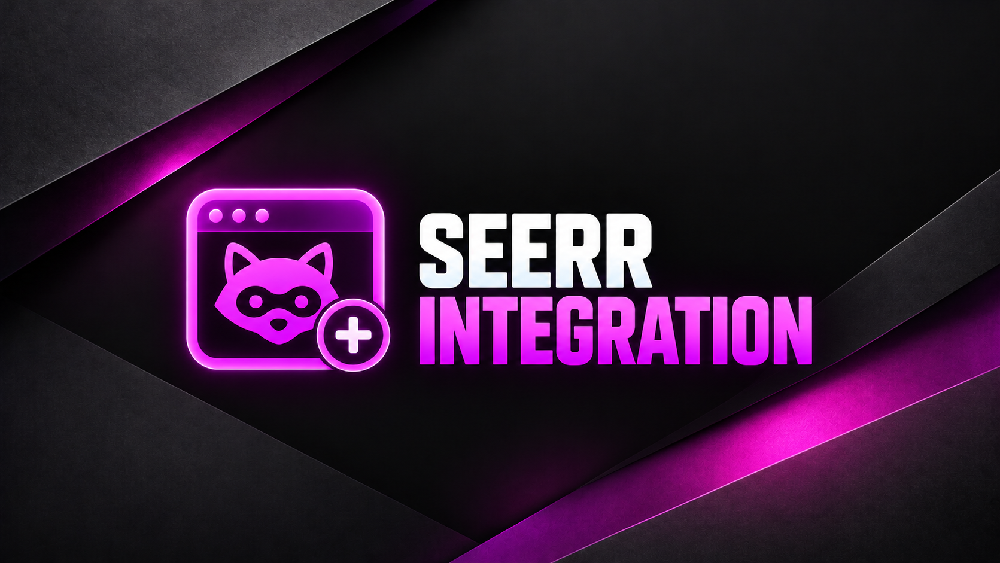
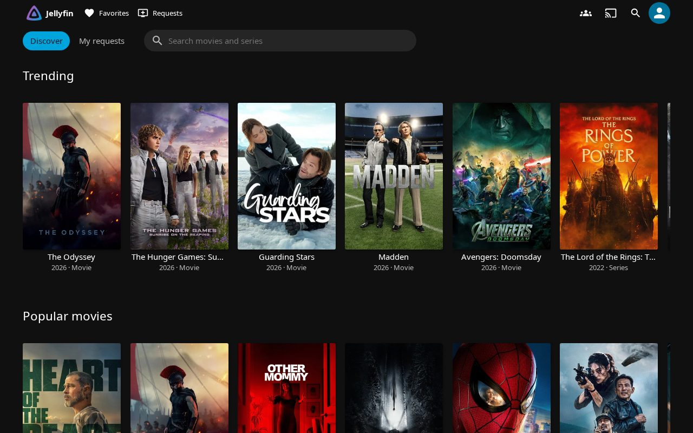
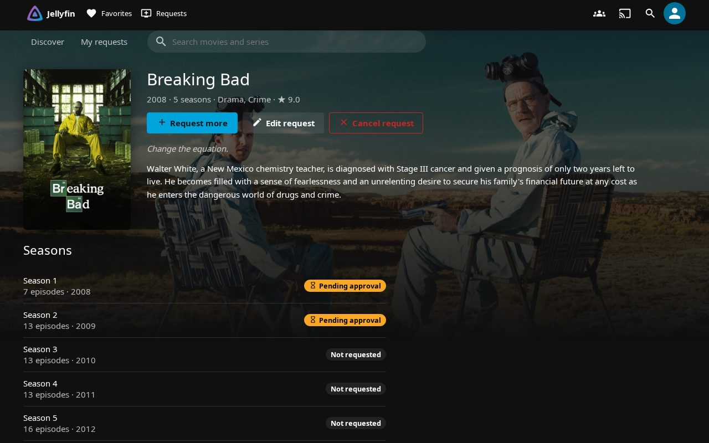

  

# jellyfin-plugin-seerr-integration

  
  
  
  
  
  
  

A Jellyfin plugin that adds a **Requests** page to Jellyfin Web. Users browse trending and popular movies and series from Seerr, search, open details, and request titles or single seasons without leaving Jellyfin and without a second login. Every request is made as the signed-in Jellyfin user through [Seerr Proxy](https://github.com/voc0der/jellyfin-plugin-seerr-proxy), so Alice's requests belong to Alice and Bob's to Bob.

  

  

## Features

- Requests entry in the navigation: the side menu in the Desktop, Mobile and TV display modes, and the app bar and phone menu in the default display mode
- Trending, popular and upcoming movies and series, with poster badges for available, requested and pending titles
- Search with poster results
- Movie and series details with recommendations
- Request a movie, or pick seasons of a series, including 4K when the server and the user allow it
- See when a title is already requested, by you or by someone else
- Download progress for requested titles on their way, from Seerr's view of the Radarr and Sonarr queues
- My requests, filtered by status, with editing of pending series requests and cancelling of pending requests
- Clear messages for unlinked accounts, missing permissions, quotas and an unreachable Seerr
- Follows the active Jellyfin theme on desktop and phone screens, and in the Jellyfin Android app

## Requirements

- Jellyfin 12
- [Seerr Proxy](https://github.com/voc0der/jellyfin-plugin-seerr-proxy), connected to Seerr
- [JavaScript Injector](https://github.com/n00bcodr/Jellyfin-JavaScript-Injector), which loads the page into Jellyfin Web
- Jellyfin users imported into Seerr. Users who are not linked see a message instead of the page

## Installation

### Plugin Catalog

1. Open **Dashboard -> Plugins -> Repositories**
2. Add `https://raw.githubusercontent.com/voc0der/jellyfin-plugin-seerr-integration/main/manifest.json`
3. Install **Seerr Integration** from **Catalog**
4. Install **Seerr Proxy** and **JavaScript Injector** if they are not installed yet
5. Restart Jellyfin

> [!NOTE]
> Full repository of this author's plugins: [voc0der/jellyfin-plugins](https://github.com/voc0der/jellyfin-plugins).

### Manual Install

1. Download the latest ZIP from the releases page
2. Extract it into your Jellyfin plugins directory
3. Restart Jellyfin

## Setup

1. Set up Seerr Proxy with your Seerr URL and API key, and enable it
2. Import your Jellyfin users in Seerr
3. Open **Dashboard -> Plugins -> Seerr Integration** and check that every status line is green
4. Reload Jellyfin Web. **Requests** appears in the navigation

The settings page has one switch, to show or hide the Requests page. What each user may request is set in Seerr, per user, as usual.

## How requests are attributed

The page sends every Seerr call to Seerr Proxy with the user's own Jellyfin session. The proxy finds that user's linked Seerr account and makes the call as that account. The page never sends a user id and never talks to Seerr directly, and Seerr's API key stays on the server. Details are in [docs/DESIGN.md](docs/DESIGN.md).

## Build Manually

See [CONTRIBUTING.md](CONTRIBUTING.md) for development information.
